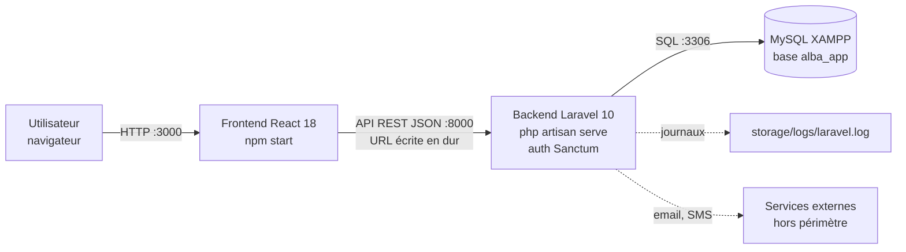
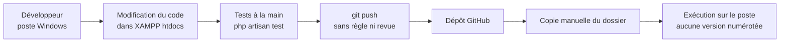
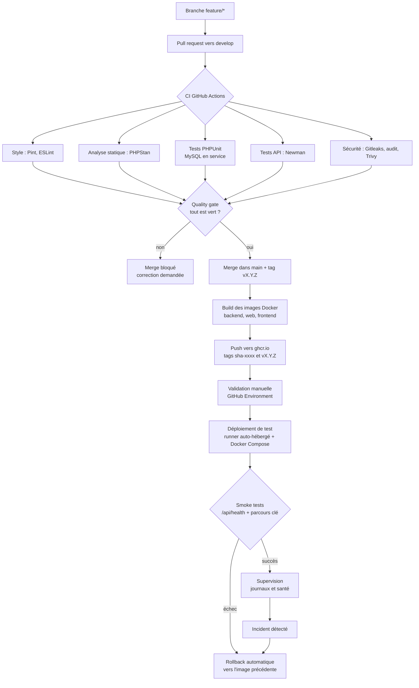

# Schémas de la Semaine 1

## 1. Architecture de l'application (état actuel)

| Composant | Rôle | Point faible actuel |
|---|---|---|
| React | Interface (25 composants) | Adresse de l'API écrite 89 fois dans le code |
| Laravel | API REST, règles métier | Routes presque toutes publiques, CORS ouvert |
| MySQL | Données | Base créée à la main |
| Journal | Diagnostic | Fichier local, aucune supervision |

## 2. Flux de livraison actuel

Problèmes : aucune vérification automatique, aucun artefact versionné, aucun retour arrière, aucune supervision.

## 3. Flux cible de la chaîne DevOps

| Étape | Semaine | Lot |
|---|---|---|
| Dépôt, branches, pull requests | 2 | Git et collaboration |
| Pipeline minimale, puis build | 3 à 4 | CI et build |
| Style, analyse statique, tests, quality gate | 5 à 6 | Qualité et tests |
| Images Docker et registre | 7 à 8 | Docker et registre |
| Configurations et secrets | 8 | Configuration |
| Déploiement et smoke tests | 9 | Déploiement |
| Sécurité (DevSecOps) | 10 | Sécurité |
| Supervision, incident, rollback | 11 à 12 | Supervision |
