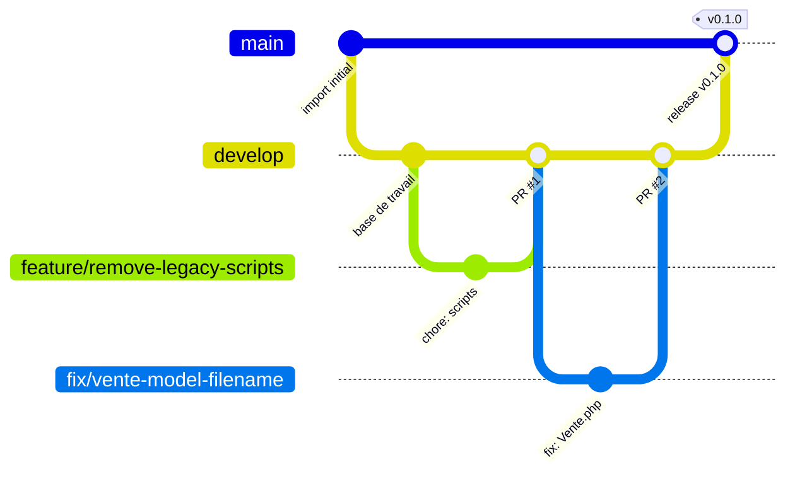

# Stratégie Git et règles de collaboration

## 1. Branches

| Branche | Rôle | Qui y écrit |
|---|---|---|
| `main` | Versions stables, prêtes à être livrées. Chaque fusion reçoit un tag `vX.Y.Z`. | Fusion depuis `develop` uniquement, par pull request |
| `develop` | Branche d'intégration et **branche par défaut** du dépôt. Les pull requests la visent automatiquement. | Fusion depuis les branches de travail, par pull request |
| `feature/<sujet>` | Nouvelle fonctionnalité ou nouveau lot de la chaîne (exemple : `feature/ci-pipeline`) | Une seule personne, durée courte |
| `fix/<sujet>` | Correction d'un défaut (exemple : `fix/vente-model-filename`) | Une seule personne, durée courte |
| `chore/<sujet>` | Nettoyage ou maintenance sans effet fonctionnel | Une seule personne, durée courte |

## 2. Règles de travail

1. Aucun commit direct sur `main` ni sur `develop`.
2. Chaque modification part d'une branche créée à partir de `develop` à jour.
3. Chaque branche donne lieu à une pull request vers `develop`, avec une description (quoi, pourquoi, impact).
4. Une pull request ne contient qu'un sujet.
5. À partir de la Semaine 3, la pull request ne peut être fusionnée que si la pipeline CI est verte.
6. La branche est supprimée après la fusion.
7. Les secrets (`.env`, mots de passe, clés) ne sont jamais versionnés.

## 3. Convention de messages de commit

Format : `type: description courte à l'impératif, sans point final`

| Type | Usage | Exemple |
|---|---|---|
| `feat` | Nouvelle fonctionnalité | `feat: add health check route` |
| `fix` | Correction de défaut | `fix: rename vente.php to Vente.php for PSR-4 compliance` |
| `ci` | Pipeline, workflows | `ci: add phpunit job` |
| `build` | Docker, dépendances | `build: add backend Dockerfile` |
| `chore` | Maintenance, nettoyage | `chore: remove legacy local setup scripts` |
| `docs` | Documentation | `docs: add branching strategy` |
| `test` | Tests | `test: tag known defects` |
| `refactor` | Réorganisation sans changement de comportement | `refactor: move backend into backend folder` |

Le message tient sur **une ligne** (72 caractères au maximum).

## 4. Versionnement

Les versions suivent le principe `vMAJEUR.MINEUR.CORRECTIF` (exemple : `v0.1.0`). Chaque version publiée est un tag sur `main` et correspond à une image Docker du même nom.

## 5. Protection de `main`

Un ruleset `protect-main` est défini sur GitHub : fusion par pull request obligatoire, suppression et force push interdits.

**Limite constatée :** sur un dépôt privé avec un compte gratuit, GitHub n'applique pas les rulesets (« Your rulesets won't be enforced on this private repository until you move to GitHub Team »). La règle est donc respectée **par discipline** : aucun push direct sur `main` ni `develop`, historique du dépôt à l'appui (toutes les modifications passent par une pull request).

Cette limite est signalée comme un écart connu par rapport à la bonne pratique.
