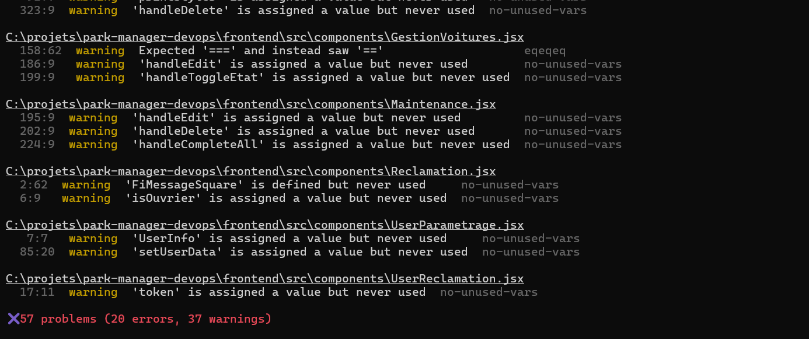
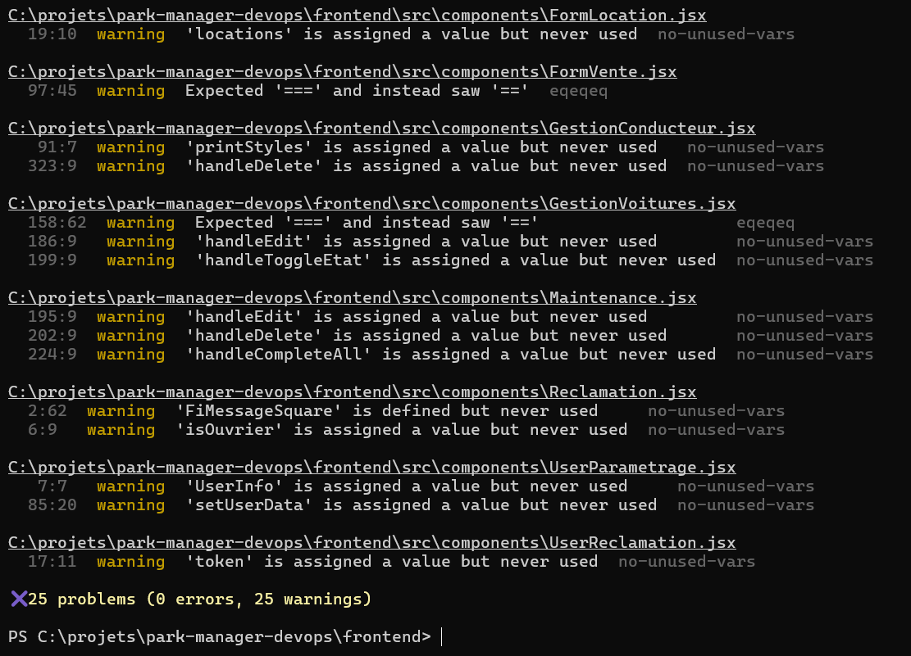
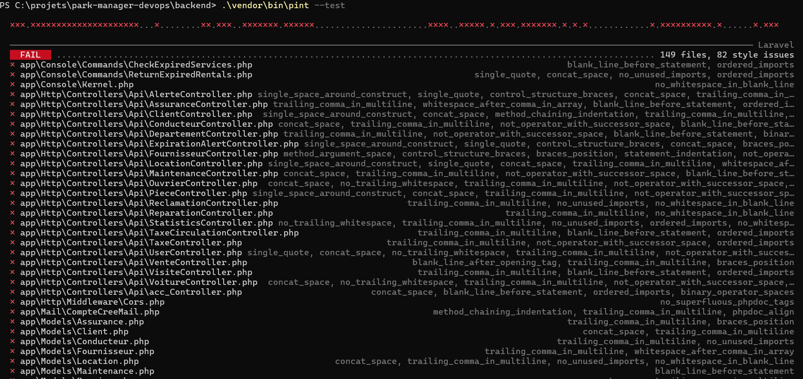
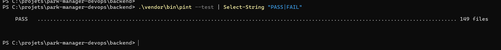
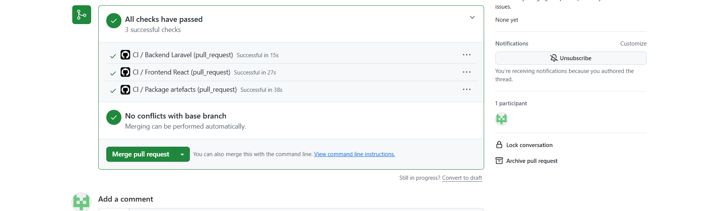
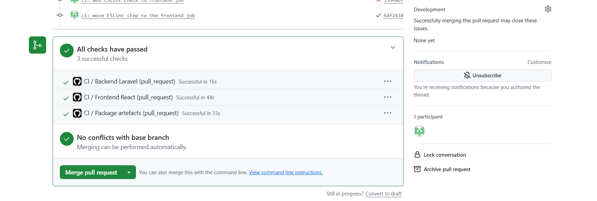
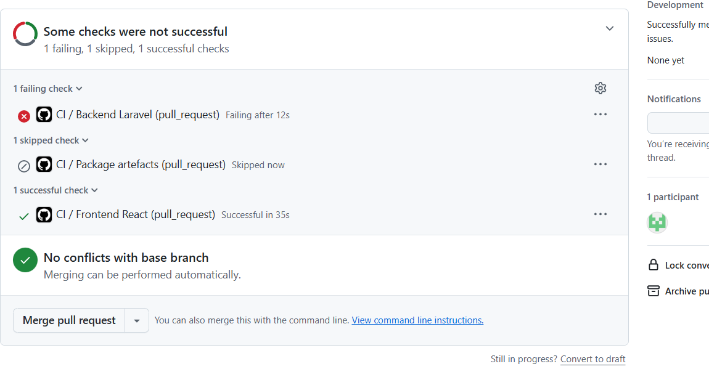
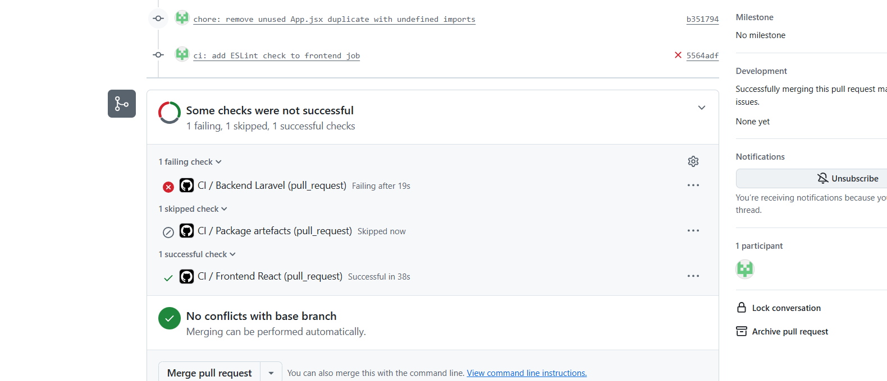

# Semaine 5 – Qualité du code et analyse statique

## 1. Objectif

L'objectif de cette semaine est d'améliorer la qualité du code source de Park Manager en intégrant des outils d'analyse statique et de vérification automatique dans le pipeline d'intégration continue (CI).

Les outils utilisés sont :
- **ESLint** pour analyser le frontend React.
- **Laravel Pint** pour vérifier le formatage du backend Laravel.

## 2. Analyse du frontend avec ESLint

### 2.1 Résultat initial

La première analyse ESLint a détecté **57 problèmes** :
- 20 erreurs ;
- 37 avertissements.

Une correction a ensuite été réalisée en supprimant le fichier `frontend/src/App.jsx`, qui était un composant dupliqué et inutilisé.

**Preuve – ESLint avant correction :**

[](Captures/S5_05_eslint_avant.png)

### 2.2 Résultat après correction

Après cette correction, l'analyse a donné :
- 0 erreur ;
- 25 avertissements.

Le nombre d'erreurs est donc passé de 20 à 0.

**Preuve – ESLint après correction :**

[](Captures/S5_06_eslint_apres.png)

## 3. Vérification du backend avec Laravel Pint

Laravel Pint a été utilisé pour contrôler le formatage du code PHP. Une première vérification a identifié des fichiers nécessitant une correction, puis une nouvelle vérification a été effectuée après correction.

**Avant correction :**

[](Captures/S5_01_pint_avant.png)

**Après correction :**

[](Captures/S5_02_pint_apres.png)

## 4. Intégration des contrôles dans GitHub Actions

Les contrôles ESLint et Laravel Pint ont été intégrés au workflow GitHub Actions situé dans :

` .github/workflows/ci.yml `

Ils permettent d'automatiser les vérifications de qualité lors de l'exécution du pipeline.

**Pipeline après l'intégration de Pint :**

[](Captures/S5_04_pint_dans_ci_vert.png)

**ESLint dans le pipeline CI :**

[](Captures/S5_07_eslint_dans_ci.png)

Les captures suivantes montrent également des exécutions en échec rencontrées pendant la configuration et la correction des contrôles :

[](Captures/S5_03_pipeline_rouge_style.png)

[](Captures/S5_08_pipeline_rouge_eslint.png)

## 5. Vérification de la compilation du frontend

La commande suivante a été utilisée pour vérifier la compilation du frontend :

```bash
npm run build
```

La compilation s'est terminée avec succès, avec des avertissements qui n'ont pas empêché la génération du build.

## 6. Gestion des modifications avec Git

Les modifications ont été organisées dans des branches dédiées et intégrées à `develop` à travers des Pull Requests :

- **PR #7 :** intégration des contrôles de qualité ESLint et Laravel Pint.
- **PR #8 :** suppression du composant React dupliqué et inutilisé.

Les modifications ont été fusionnées après vérification.

## 7. Bilan de la semaine

À la fin de cette semaine :
- ESLint est intégré dans le pipeline CI.
- Laravel Pint est intégré dans le pipeline CI.
- Le nombre d'erreurs ESLint est passé de 20 à 0.
- Le nombre d'avertissements ESLint est passé de 37 à 25.
- La compilation du frontend fonctionne.
- Les contrôles de qualité sont automatisés avec GitHub Actions.

## 8. Conclusion

Cette semaine a permis d'améliorer la qualité du code source du projet Park Manager grâce à ESLint et Laravel Pint. L'automatisation de ces contrôles dans GitHub Actions permet de détecter plus rapidement les problèmes de qualité avant l'intégration des modifications dans la branche de développement.

---

**Remarque sur les preuves :** les images sont liées avec des liens Markdown cliquables. Pour que les images s'affichent, conserve ce fichier dans le dossier `docs` et garde le dossier `Captures` à côté, avec les noms de fichiers indiqués ci-dessus.
