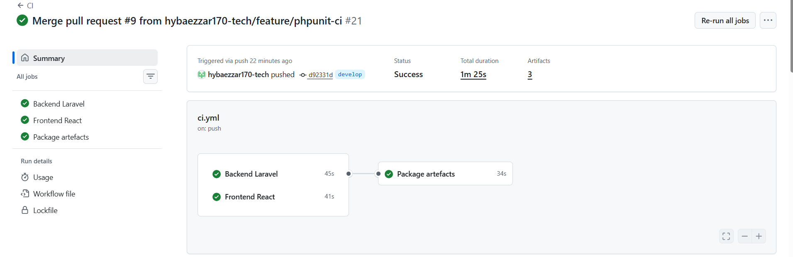
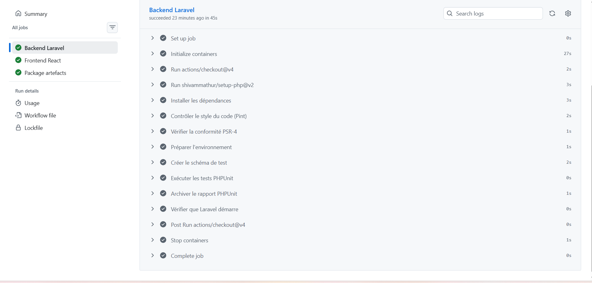
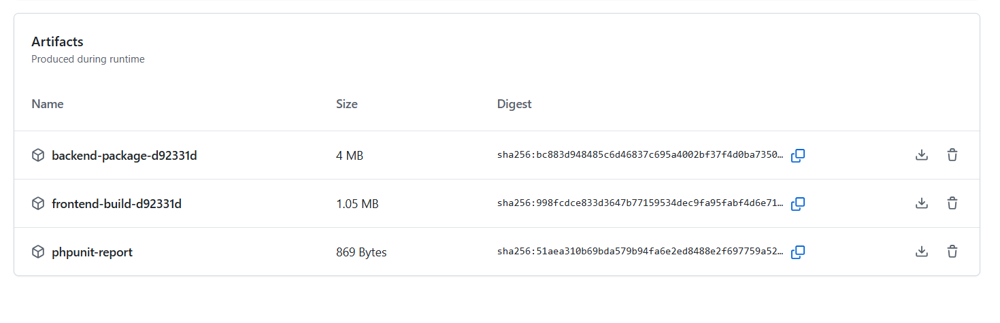
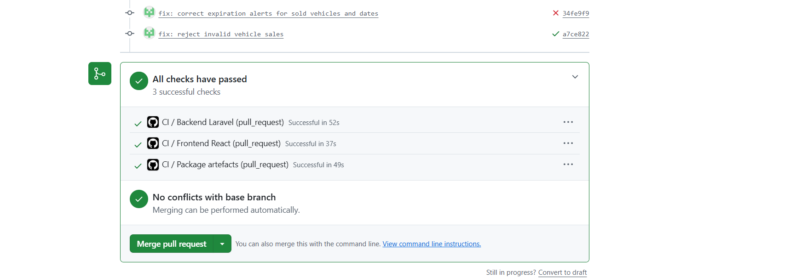

# Semaine 6 – Intégration continue et tests automatisés

## 1. Objectif de la semaine

L'objectif de cette étape est de renforcer le pipeline d'intégration continue du projet Park Manager en automatisant l'exécution des tests backend avec une base de données MySQL temporaire.

Le workflow GitHub Actions vérifie le backend Laravel, le frontend React et la génération des artefacts du projet.

## 2. Configuration du workflow GitHub Actions

Le workflow est défini dans le fichier :

`.github/workflows/ci.yml`

Il est déclenché lors des événements suivants :
- `push` sur les branches `develop` et `main` ;
- `pull_request` vers les branches `develop` et `main`.

Le workflow contient trois jobs principaux :

1. **Backend Laravel** : installation des dépendances PHP, contrôles de qualité, configuration de la base de données, migrations et tests PHPUnit.
2. **Frontend React** : installation des dépendances Node.js, contrôles ESLint et compilation du frontend.
3. **Package artifacts** : préparation et publication des artefacts du frontend et du backend.

**Preuve – Workflow CI :**

[](Captures/S6_01_workflow_ci.png)

## 3. Configuration de MySQL pour les tests

Un service MySQL 8 est configuré dans le job backend de GitHub Actions.

La base `alba_test` est utilisée uniquement pendant l'exécution du pipeline. Les variables d'environnement de test configurent notamment le type de connexion, l'hôte et le port du service, le nom de la base et les identifiants de test définis dans le workflow.

Cette base est temporaire et isolée de la base de données locale de développement.

Les migrations sont exécutées dans l'environnement CI avec :

```bash
php artisan migrate --force
```

**Preuve – Configuration MySQL / migrations :**

[](Captures/S6_02_mysql_migrations.png)

## 4. Exécution des tests PHPUnit

Les tests automatisés du backend sont exécutés dans le job Laravel avec la commande :

```bash
php vendor/bin/phpunit --log-junit reports/junit.xml
```

Le rapport JUnit est généré dans `backend/reports/junit.xml`, puis publié comme artefact GitHub Actions sous le nom `phpunit-report`.

Pendant la mise en place, plusieurs problèmes ont été identifiés et corrigés :
- problèmes liés à l'ordre d'exécution de certaines migrations et aux clés étrangères ;
- exécution de PHPUnit dans l'environnement Linux ;
- calcul des jours restants et alertes concernant les véhicules vendus ;
- validation du prix de vente et de l'état du véhicule avant une vente.

Les corrections ont été intégrées dans la branche de développement à travers la Pull Request **#9**.

**Éléments de vérification – Exécution PHPUnit :**

La capture dédiée à cette exécution n'a pas été conservée. Le rapport JUnit publié comme artefact `phpunit-report` et le statut des checks CI constituent les éléments de vérification disponibles.

## 5. Publication du rapport de tests

Après l'exécution de PHPUnit, le workflow téléverse le rapport JUnit comme artefact nommé `phpunit-report`.

La durée de conservation configurée pour cet artefact est de 14 jours.

**Preuve – Artefact du rapport PHPUnit :**

[](Captures/S6_04_artifact_phpunit.png)

## 6. Résultat du pipeline

Après les corrections et la fusion de la Pull Request **#9**, les trois vérifications GitHub Actions affichées sur la Pull Request sont réussies :

- CI / Backend Laravel ;
- CI / Frontend React ;
- CI / Package artifacts.

GitHub indique également que tous les checks ont réussi et qu'il n'y a pas de conflit avec la branche cible.

**Preuve – Les trois checks réussis :**

[](Captures/S6_05_all_checks_passed.png)

## 7. Bilan de la semaine

Les objectifs principaux de cette étape ont été réalisés :

- configuration d'un service MySQL 8 pour les tests CI ;
- exécution automatique des migrations dans une base temporaire ;
- exécution de PHPUnit dans le job backend ;
- génération et publication du rapport JUnit ;
- validation des jobs backend, frontend et packaging ;
- fusion des modifications dans `develop`.

## 8. Conclusion

Cette étape a permis d'automatiser davantage la validation du projet Park Manager. Le pipeline ne se limite plus à vérifier l'installation et la compilation : il exécute également les migrations et les tests backend dans un environnement MySQL isolé.

La réussite des trois jobs GitHub Actions après les corrections confirme le bon fonctionnement du workflow de validation intégré dans la branche `develop`.
