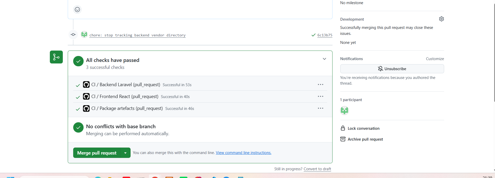
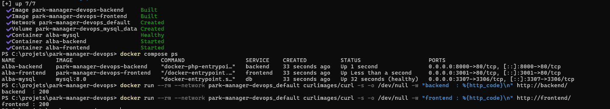
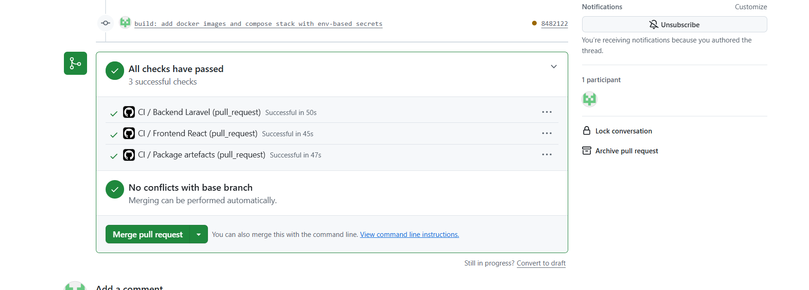

# SEMAINE 7 — CONTENEURISATION DE L'APPLICATION

**Projet :** Park Manager
**Module :** DevOps
**Environnement :** Docker, Docker Compose, Laravel, React et MySQL

---

## 1. Objectif

L'objectif de cette semaine est de préparer la conteneurisation de l'application afin de faciliter son déploiement et de rendre son environnement plus reproductible.

## 2. Réalisations

- Retrait du dossier `backend/vendor` du suivi Git.
- Création du Dockerfile du backend Laravel.
- Création du Dockerfile du frontend React.
- Mise en place du fichier `docker-compose.yml`.
- Configuration des services MySQL, backend et frontend.
- Utilisation du fichier `.env.docker` pour les variables d'environnement.
- Définition d'un volume persistant pour les données MySQL.
- Ajout d'un contrôle de santé (healthcheck) pour MySQL.
- Intégration des modifications dans la branche `develop` via les Pull Requests.

## 3. Architecture Docker

| Service | Technologie | Port hôte |
|---|---|---|
| db | MySQL 8.0 | 3307 |
| backend | Laravel / Apache | 8000 |
| frontend | React / Nginx | 3001 |

Le fichier `docker-compose.yml` définit les trois services et le volume `mysql_data`.

## 4. Intégration GitHub

Les réalisations ont été intégrées dans `develop` :

- PR #10 : retrait du dossier `vendor`.
- PR #11 : ajout des Dockerfiles et de Docker Compose.
- PR #12 : ajout du build des images Docker dans la CI.

## 5. Captures d'écran

### 5.1 Retrait du dossier vendor

### 5.2 Test réseau Docker

### 5.3 Intégration des Dockerfiles

## 6. Vérifications et limites

La configuration du fichier `docker-compose.yml` a été vérifiée avec `docker compose config`.

Les conteneurs actuellement actifs ont été identifiés comme provenant de `docker-compose.test.yml`, utilisé pour la validation de la semaine 9. Leur fonctionnement ne constitue donc pas une preuve de démarrage de la stack définie dans le fichier principal de la semaine 7.

Le démarrage indépendant de cette stack reste à vérifier.

## 7. Conclusion

La structure de conteneurisation de l'application est mise en place et les modifications sont intégrées dans la branche `develop`. La validation complète du démarrage de la stack principale reste une étape à effectuer.
