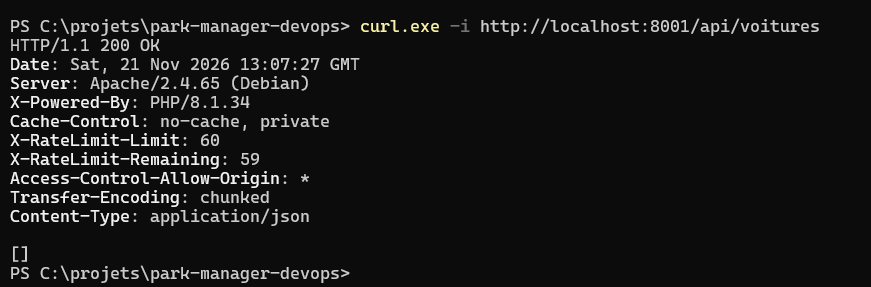
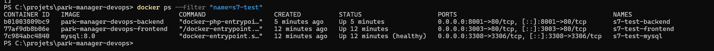

# SEMAINE 7 — CONTENEURISATION DE L'APPLICATION

**Projet :** Park Manager  
**Module :** DevOps  
**Environnement :** Docker, Docker Compose, Laravel, React et MySQL

---

## 1. Objectif

L'objectif de cette semaine est de préparer la conteneurisation de l'application afin de faciliter son déploiement et de rendre son environnement plus reproductible.

## 2. Réalisations

- Retrait du dossier `backend/vendor` du suivi Git.
- Création du Dockerfile du backend Laravel.
- Création du Dockerfile du frontend React.
- Mise en place du fichier `docker-compose.yml`.
- Configuration des services MySQL, backend et frontend.
- Utilisation du fichier `.env.docker` pour les variables d'environnement.
- Définition d'un volume persistant pour les données MySQL.
- Ajout d'un contrôle de santé (healthcheck) pour MySQL.
- Intégration des modifications dans la branche `develop` via les Pull Requests.

## 3. Architecture Docker

| Service | Technologie | Port hôte |
|---|---|---|
| db | MySQL 8.0 | 3307 |
| backend | Laravel / Apache | 8000 |
| frontend | React / Nginx | 3001 |

Le fichier `docker-compose.yml` définit les trois services et le volume `mysql_data`.

## 4. Intégration GitHub

Les réalisations ont été intégrées dans `develop` :

- PR #10 : retrait du dossier `vendor`.
- PR #11 : ajout des Dockerfiles et de Docker Compose.
- PR #12 : ajout du build des images Docker dans la CI.

## 5. Captures d'écran

### 5.1 Retrait du dossier vendor

### 5.2 Test réseau Docker

### 5.3 Intégration des Dockerfiles

### 5.4 Vérification de l'API backend

### 5.5 Conteneurs Docker actifs

## 6. Vérifications et tests

La configuration du fichier `docker-compose.yml` a été vérifiée avec la commande :

`docker compose config --quiet`

Une configuration temporaire isolée a ensuite permis de tester les Dockerfiles et les services sans conserver les mêmes ports que l'environnement S9.

Les vérifications effectuées sont les suivantes :

- Construction des images Docker backend et frontend réussie.
- Démarrage des trois conteneurs : MySQL, backend et frontend.
- MySQL déclaré `healthy`.
- Frontend accessible sur `http://localhost:3003`.
- Connexion du backend à MySQL avec `DB_HOST=db`.
- Exécution réussie des migrations Laravel avec `php artisan migrate --force`.
- Test de l'API `GET /api/voitures` : réponse HTTP 200 OK.

La stack S9 a ensuite été redémarrée et son API a également répondu HTTP 200 OK sur `http://localhost:8000/api/voitures`.

**Remarque :** les tests de démarrage ont été réalisés avec une configuration temporaire utilisant les Dockerfiles du projet. Le démarrage du fichier Compose principal sur ses ports propres n'a pas été validé directement.

## 7. Conclusion

La conteneurisation de l'application est mise en place. Les images backend et frontend ont été construites avec succès, les conteneurs ont démarré, la connexion à MySQL a été vérifiée et les migrations Laravel ont été exécutées. Le fonctionnement de l'API a été confirmé par une réponse HTTP 200 OK.

Les modifications sont intégrées dans la branche `develop`. La semaine 7 dispose désormais de preuves de construction et de fonctionnement des composants Docker.
