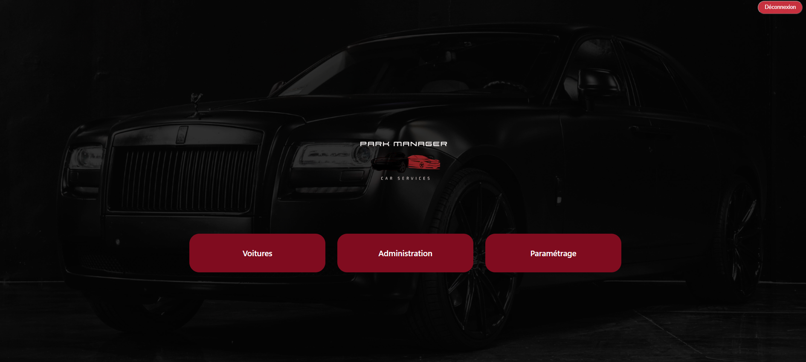
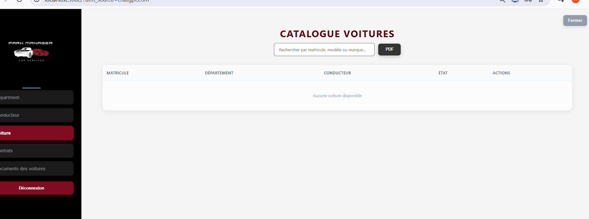
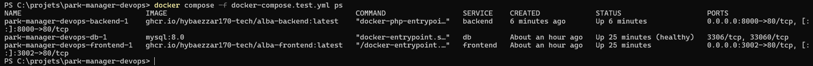

# SEMAINE 9 — DÉPLOIEMENT ET VALIDATION

**Projet :** Park Manager
**Module :** DevOps
**Environnement :** Docker, Docker Compose, Laravel, React et MySQL

---

## 1. Objectif

Déployer Park Manager dans un environnement de test isolé et vérifier le bon fonctionnement de ses différents services.

## 2. Architecture technique

| Service | Technologie | Port |
|---|---|---|
| Frontend | React / Nginx | 3002 |
| Backend | Laravel / Apache | 8000 |
| Base de données | MySQL 8.0 | Réseau interne Docker |

## 3. Réalisation du déploiement

Les opérations suivantes ont été effectuées :

- Récupération des images depuis GitHub Container Registry (GHCR).
- Déploiement des services avec Docker Compose.
- Configuration de la connexion entre Laravel et MySQL.
- Initialisation de la base de données.
- Exécution des migrations Laravel.
- Création des utilisateurs de test avec UserSeeder.

## 4. Résultats des tests

| Test effectué | Résultat |
|---|---|
| Démarrage des conteneurs | Réussi |
| Accès au frontend | Réussi |
| Accès au backend | Réussi |
| Connexion MySQL | Réussie |
| Migrations Laravel | Réussies |
| API Voitures | HTTP 200 |
| API Clients | HTTP 200 |
| API Maintenances | HTTP 200 |
| Authentification administrateur | Réussie |
| Navigation dans l'application | Réussie |

## 5. Preuves du déploiement

### 5.1 Tableau de bord

### 5.2 Module de gestion des voitures

### 5.3 Conteneurs Docker

## 6. Difficultés rencontrées et solutions

**Problème 1 :** Le frontend ne parvenait pas à communiquer avec le backend.

**Solution :** Adaptation du port du backend au port attendu par le frontend.

**Problème 2 :** Une erreur HTTP 500 était provoquée par l'absence des tables dans la base de test.

**Solution :** Exécution des migrations Laravel.

**Problème 3 :** L'authentification retournait une erreur HTTP 401.

**Solution :** Exécution du UserSeeder afin de créer les comptes de test.

## 7. Conclusion

Le déploiement de l'application Park Manager dans un environnement Dockerisé a été réalisé avec succès.

Les tests effectués confirment le bon fonctionnement du frontend, du backend, de la base de données et du système d'authentification.

**La validation fonctionnelle de l'environnement de test S9 est réussie.**

